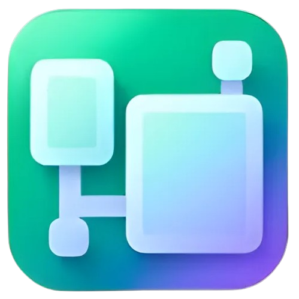

<div align="center">
  
  <h1>Xopilot</h1>
  <p><strong>Твой ИИ. Твои проекты. Твои устройства.</strong></p>
  <p>Чаты, рабочие пространства, Canvas и голосовой Live<br/>в одном приложении для компьютера и Android.</p>
  <p>
    <a href="https://github.com/Xopilot-AI-NN/Xopilot/releases">Скачать</a> ·
    <a href="#возможности">Возможности</a> ·
    <a href="#быстрый-старт">Разработка</a> ·
    <a href="tests/REPORTS.md">Отчёты проверок</a> ·
    <a href="mailto:support@xopilot.by">Поддержка</a>
  </p>
  <p>
     
     </p>
</div>

> **В разработке.** Последний опубликованный dev-тег — `dev-v2.0.11`. Это предварительные сборки: результаты по конкретным устройствам и ограничения перечислены в [REPORTS.md](tests/REPORTS.md). Наличие функции в интерфейсе не означает, что она проверена на каждом устройстве.

## Возможности

| Для чего | Что умеет Xopilot |
|---|---|
| **Общение** | История и поиск чатов, вложения, Markdown, очередь уточнений, выбор локальной модели или API |
| **Проекты** | Рабочие пространства с инструкциями, библиотекой и выбранной папкой; инструменты создания файлов и выполнения команд на ПК |
| **Canvas** | Текст, код, рисунки и предпросмотр сайтов; доступность предпросмотра зависит от платформы |
| **Агент** | Поиск по доступным чатам, работа с файлами и сайтами, журнал действий, пауза и продолжение; ручное или явно выбранное автоматическое подтверждение |
| **Live** | Реплики с микрофона, голосовой ответ, текстовые вопросы, камера и экран. Нужны совместимая аудиомодель, разрешения и установленный голос |
| **Между устройствами** | Сквозное шифрование синхронизации отдельным паролем, выбор категорий, автосинхронизация и лимит исходящего трафика |
| **Хранилище** | Локальные и облачные материалы, просмотр и сохранение, удаление копий, объяснение занятого объёма и поиск прежних вложений |
| **Приватность** | Защищённые чаты с отдельным паролем; временные чаты остаются локальными и не входят в облачную синхронизацию |

Локальные модели и свой API-ключ можно использовать без покупки облачной модели Xopilot. Возможности изображения и аудио зависят от выбранной модели. Камера и экран передают кадр для вопроса, а не непрерывный видеопоток в модель.

При заполнении контекста приложение резервирует место для ответа и просит ту же модель сжать старую переписку. Короткие важные выдержки пользователя сохраняются дословно, поздние исправления имеют приоритет. Исходные сообщения в БД остаются целыми. Размер окна берётся из настроенного локального runtime, метаданных Google/OpenRouter или явной ошибки провайдера; для неизвестного API лимит не выдумывается. Сводка помогает продолжить разговор, но не гарантирует безошибочную память модели.

На совместимых настольных сборках LiteRT вызовы инструментов Gemma ограничены JSON-схемой доступных действий. На других runtime остаются проверка формата и исправление ответа; разрешения файлов и подтверждения команд проверяются приложением в обоих случаях. Под ответом показывается полное время подготовки, включая паузы и ожидание подтверждений; оно сохраняется в истории и синхронизации.

## Платформы

- **Linux** — настольный интерфейс, локальный ИИ и инструменты проектов. Доступ к экрану и приложениям зависит от Wayland/X11, порталов и accessibility.
- **Windows** — отдельная сборка GitHub Actions; совместимость драйверов и моделей нужно проверять на целевом ПК.
- **Android** — адаптивный интерфейс, системные разрешения и аппаратно привязанное хранилище ключа. ARM64 APK проверялись на POCO X5 5G и Redmi 7A. Тяжёлая локальная модель не подходит каждому телефону.
- **ChromeOS** — отдельное устройство пока не проверено. Поддержка Android-приложений в ChromeOS сама по себе не гарантирует работу всех функций Xopilot.

## Синхронизация и защита данных

1. Войдите в один аккаунт на устройствах.
2. В разделе **Аккаунт → Синхронизация** введите один и тот же отдельный пароль синхронизации.
3. Включите нужные категории и автосинхронизацию.

При открытом приложении проверка изменений выполняется раз в секунду: целевая задержка между двумя устройствами — **около 2 секунд плюс время передачи**. При занятом чате, конфликте, отключённой сети или исчерпанном лимите трафика обновление может задерживаться. Это не фоновая гарантия Android и не синхронизация каждого нажатия клавиши. Несохранённые черновики не отправляются как сообщения.

Сервер хранит зашифрованные данные синхронизации и служебные метаданные аккаунта. Пароль входа, пароль защищённых чатов и пароль синхронизации имеют разное назначение. История и настройки хранятся в SQLCipher; отдельные локальные копии материалов не зашифрованы SQLCipher. Отправка запроса внешнему API передаёт выбранному провайдеру содержимое этого запроса.

Удаление своего аккаунта требует подтверждения и повторной проверки доступа. Облачные данные удаляются, очистка файлов ставится в очередь. Данные приложения на текущем устройстве стираются при следующем запуске. Локальные копии на других устройствах, внешние исходники и серверные резервные копии этим действием не стираются.

## Подписки Zephyr

| Тариф | В месяц | Условия |
|---|---:|---|
| **Micro** | Бесплатно | Локальный режим, свой API, базовая синхронизация; 128 МиБ облака. Micro и 3 сообщения Elite в неделю — после запуска облачных моделей |
| **Elite** | 1 000 RUB | Возможности Micro, одно активное удалённое задание на связанном ПК; модель Elite — после запуска |
| **Ultra** | 4 000 RUB | Возможности Elite, до трёх активных удалённых заданий; модель Ultra — после запуска |
| **Led** | 7 000 RUB | Доступ ко всем запущенным облачным моделям; без тарификации по токенам. Для очереди удалённых заданий действует технический предел |

Для Elite предусмотрены скидки после проверки документов: учреждениям **40%**, программистам **20%**. Для Elite/Ultra планируется докупка токенов. Конвертация валюты в интерфейсе справочная; базовая валюта — RUB.

**Платежи не активированы:** DonationAlerts авторизован владельцем, но приём оплаты отключён до запуска облачных моделей Zephyr. Таблица описывает условия будущих услуг. Регистрация по почте требует подключённого SMTP; Google имеет отдельную настройку.

## Быстрый старт

Для разработки используются **Python 3.14**, Rust и Flet. Нативное расширение должно соответствовать платформе и версии Python.

```bash
# Linux, из корня репозитория
./python/linux/bin/python -m pip install -r App/requirements.txt
./python/linux/bin/python scripts/build_native.py
./python/linux/bin/flet run -r --ignore-dirs "data,__pycache__,.pytest_cache" App/App.py
```

Встроенное окружение `python/linux` — локальное окружение разработчика, оно может отсутствовать в клоне. В этом случае создайте собственный venv Python 3.14 и используйте его команды `python` и `flet`.

```bash
# Окружение без встроенного Python
python3.14 -m venv .venv
. .venv/bin/activate
python -m pip install -r App/requirements.txt
python scripts/build_native.py
flet run App/App.py

# Проверки
python -m unittest discover -s tests
```

Сборочные сценарии находятся в [scripts](scripts); CI для Linux, Windows и Android — в [.github/workflows/build.yml](.github/workflows/build.yml). Android требует Flutter, Android SDK, JDK 21 и нативных библиотек целевой ABI. Для локальной сборки используйте `python scripts/build_android.py --help`.

Android-сборки основного репозитория используют постоянный ключ из GitHub Actions Secrets. SHA256 публичного сертификата: `52e6ebc1d0610f9c5797e6cc14e02a3920d4cf998d19eefce15f882691135ccc`. Ключ и пароли в Git не хранятся. Старые сборки с одноразовой debug-подписью могут не принимать такое обновление; перед сменой установки сохраните свои данные. Подтверждение личности разработчика в Google — отдельная процедура и пока не завершено.

## Устройство проекта

```text
App/
  app/          интерфейс: чат, проекты, Canvas, браузер, Live
  services/     модели, инструменты, хранение, шифрование, синхронизация
  settings/     настройки и аккаунт
  assets/       графика, шрифты и ресурсы
Services/       нативное расширение Rust / SQLCipher
extensions/     мобильные компоненты Flutter / Android
scripts/        сборка и проверка артефактов
tests/          тесты и REPORTS.md
```

Серверная часть и админ-панель развёртываются отдельно; их исходников и секретов в этом публичном репозитории нет. Не добавляйте в issues ключи API, токены, личные переписки или файлы OAuth.

## Обратная связь

Нашли проблему? Укажите платформу, версию и номер сборки, шаги воспроизведения, ожидаемый результат. В приложении есть подготовка письма поддержки с диагностикой — перед отправкой просмотрите вложение. Получатель: **support@xopilot.by**.

Разработчик — **DenBroLiik**. Код приложения распространяется по [MIT](LICENSE); модели, голоса и сторонние библиотеки имеют собственные лицензии.
