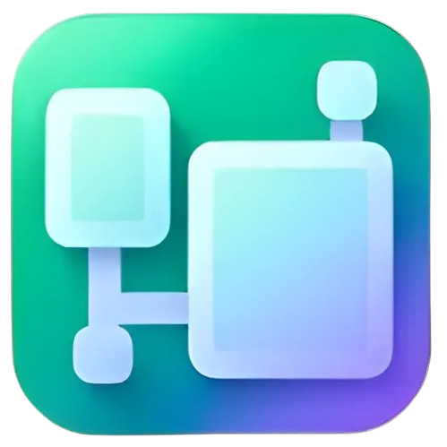
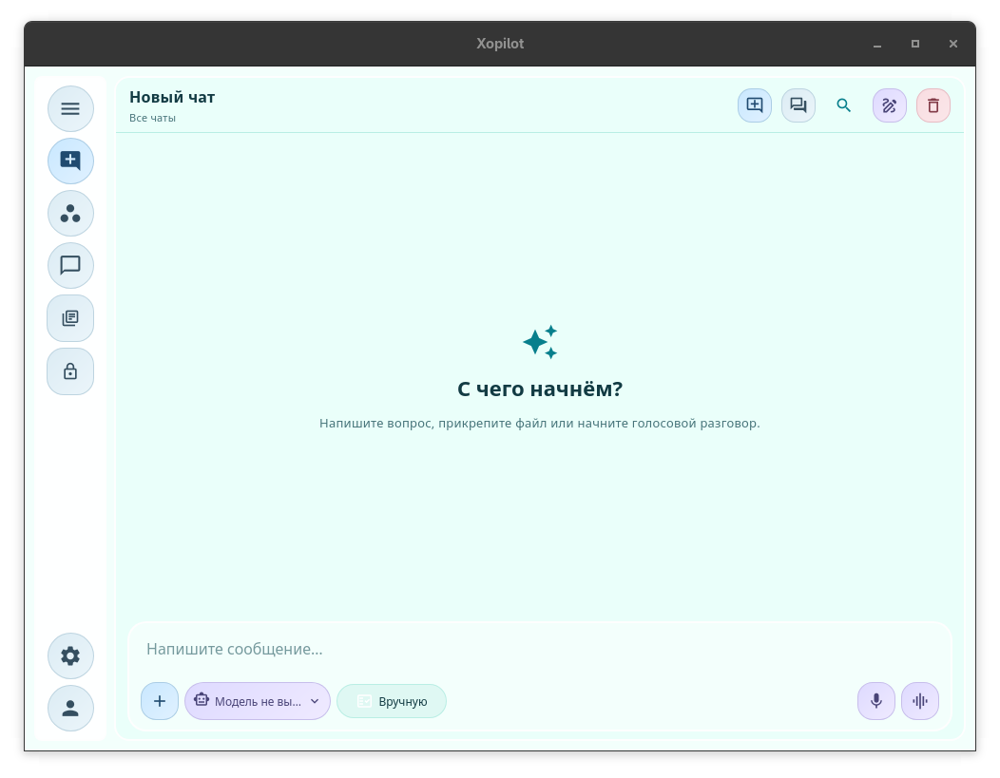
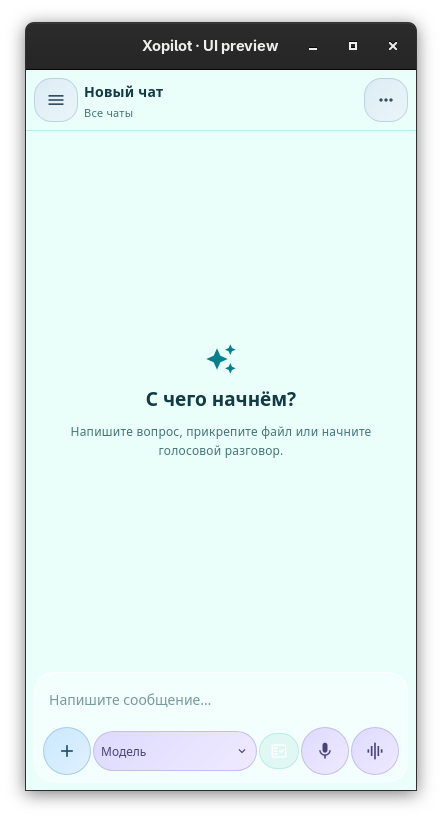
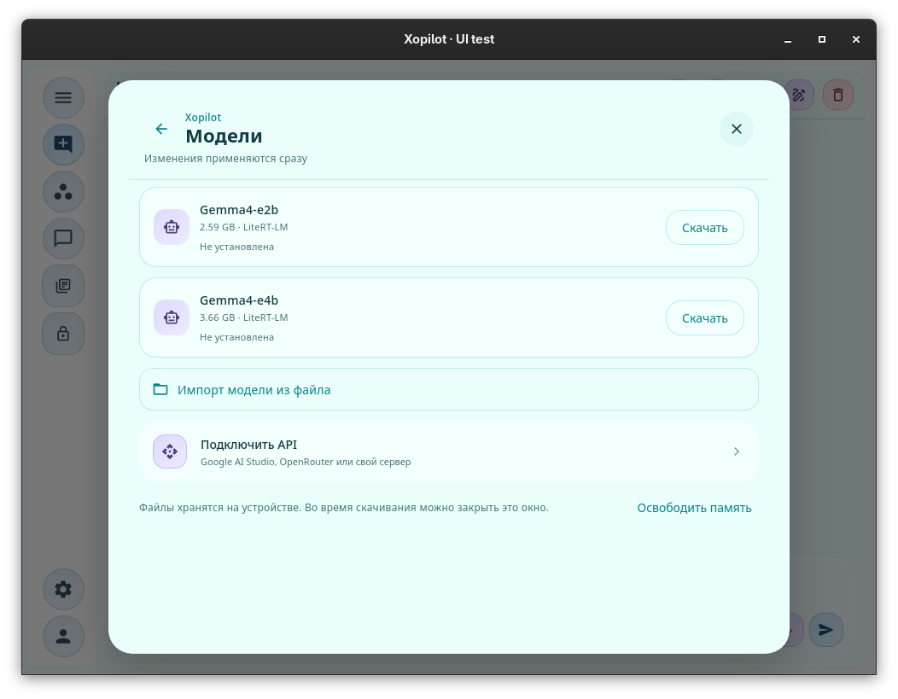
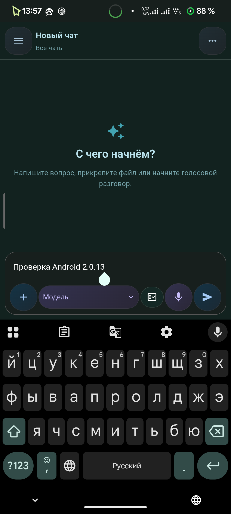
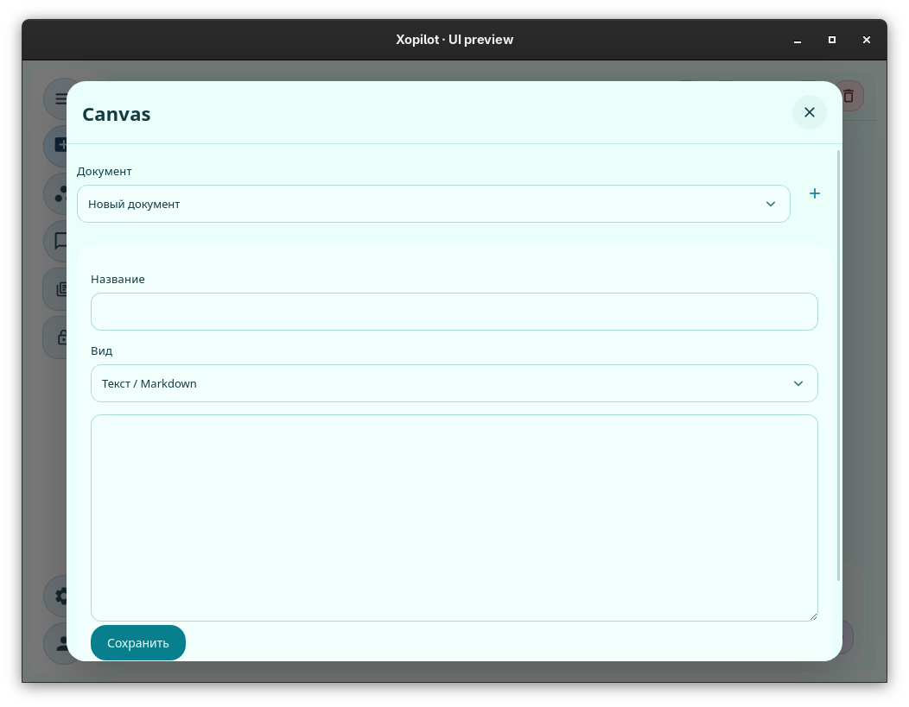
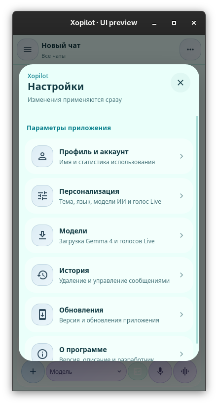

<div align="center">
  
  <h1>Xopilot</h1>
  <p><strong>Твой ИИ. Твои проекты. Твои устройства.</strong></p>
  <p>Чаты, рабочие пространства, Canvas и локальный ИИ<br/>в одном приложении для компьютера и Android.</p>
  <p>
    <a href="https://github.com/Xopilot-AI-NN/Xopilot/releases">Скачать</a> ·
    <a href="#возможности">Возможности</a> ·
    <a href="#быстрый-старт">Разработка</a> ·
    <a href="tests/RUST_DIOXUS.md">Отчёты проверок</a> ·
    <a href="mailto:support@xopilot.by">Поддержка</a>
  </p>
  <p>
     
     </p>
</div>

**Язык:** **Русский** · [English](README_EN.md)

> **В разработке · Rust 2.0.13.** Интерфейс и сервисы перенесены на Rust / Dioxus. Часть возможностей прежней версии ещё переносится; состояние каждого раздела описано в [MIGRATION.md](MIGRATION.md). Результаты проверок — [Rust / Linux](tests/RUST_DIOXUS.md) и [Android](tests/ANDROID_DEVICE.md). Локальная сборка не означает, что новый релиз уже опубликован.

## Скриншоты

<table align="center">
  <tr>
    <td align="center" valign="middle">
      <a href="previews/dioxus-main.png"></a>
    </td>
    <td align="center" valign="middle">
      <a href="previews/dioxus-mobile.png"></a>
    </td>
    <td align="center" valign="middle">
      <a href="previews/dioxus-models.png"></a>
    </td>
  </tr>
  <tr>
    <td align="center" valign="middle">
      <a href="previews/android-keyboard.png"></a>
    </td>
    <td align="center" valign="middle">
      <a href="previews/dioxus-canvas.png"></a>
    </td>
    <td align="center" valign="middle">
      <a href="previews/dioxus-mobile-settings.png"></a>
    </td>
  </tr>
</table>
## Что изменилось в dev-v2.0.13

Сравнение с последним опубликованным пререлизом [dev-v2.0.12](https://github.com/Xopilot-AI-NN/Xopilot/releases/tag/dev-v2.0.12):

- Перевёл интерфейс и сервисы с Python / Flet на **Rust / Dioxus**, убрал Python-окружения, PyO3 и Flutter из сборки. Сохранил архитектуру папок и развёрнутый стиль Rust-кода с русскими комментариями.
- Вернул привычную компоновку: меню, карточки, палитры, Canvas и настройки поверх чата. Исправил списки, размеры окон и независимую прокрутку разделов.
- Подключил нативный **LiteRT-LM** и Gemma4-e2b/e4b. Добавил SHA-256, выбор файла одной кнопкой, автоматический выбор GPU/CPU и освобождение памяти. Веса и подходящий KV-контекст переиспользуются между запросами.
- Перенёс цикл агента: чтение и изменение файлов проекта, команды, Canvas, память и поиск чатов. Добавил подтверждения, паузу, остановку и карточки действий в переписке; исправил попадание служебного JSON в ответы и проверку неподтверждённых заявлений об успехе.
- Упростил локальный профиль: он создаётся автоматически. Имя и аватар меняются по нажатию; Google и регистрация по почте остаются серверными и требуют включённого сервера.
- На Android исправил системную кнопку «Назад»: открытые окна закрываются по очереди, корневой чат сворачивается. Сохраняю чат, черновик, раздел и прокрутку для восстановления после уничтожения процесса Android.
- Передал Android-скачивание моделей системному **DownloadManager**. Загрузка и уведомление с процентом продолжаются без процесса интерфейса; при возвращении восстанавливается та же задача. После доставки файл проходит SHA-256 перед установкой. Ожидание сети возобновляется автоматически; ручная отмена удаляет системную задачу, а на ПК остаётся прежняя пауза с Range-продолжением.
- Исправил отступы строки состояния, выреза и панели навигации. Клавиатура поднимает ввод, а после закрытия интерфейс возвращается на место. Уведомления скрываются через **3 секунды**, активный прогресс остаётся.
- Вернул имя **Xopilot**, иконку и ID **by.xopilot.app**. Выровнял Android ELF/ZIP на 16 КиБ и поднял versionCode до **2000013**. Создал постоянный ключ для следующих Rust-сборок и сохранил его в GitHub Secrets, вне исходников.
- Подготовил прежнюю схему автосборки и пререлизов для Rust: **Xopilot-Dev-2_0_13-Linux.zip + Xopilot-Dev-2_0_13-Linux**, **Xopilot-Dev-2_0_13-Windows.zip + Xopilot-Dev-2_0_13-Windows.exe**, **Xopilot-Android-arm64-v8a.apk и Xopilot-Android-x86_64.apk**. Шрифты, логотип и нативный AI runtime встроены в исполняемые файлы.
- Добавил воспроизводимые проверки сервисов, настоящего интерфейса, KV-контекста, Android-моста и выравнивания APK. Команды — в [TESTING.md](tests/TESTING.md), результаты телефона — в [ANDROID_DEVICE.md](tests/ANDROID_DEVICE.md).

**Важно при переходе с 2.0.12:** Android-подпись новая. Старый APK нельзя обновить поверх прежней подписи; не удаляйте старую установку до экспорта нужной истории. Простое копирование SQLCipher-файла не заменяет сохранение ключа Keystore. Закрытый ключ новой подписи хранится отдельно и не включён в Git или архивы приложения. Публичный SHA-256 сертификата: [signing-certificate.sha256](App/android/signing-certificate.sha256).

**Ещё переношу:** Live, голоса, камеру и экран, защищённые чаты, облачную синхронизацию, биллинг и удалённые устройства. Эта версия меняет стек приложения; доступность этих возможностей не стоит приравнивать к Flet-пререлизу. Полная таблица — [MIGRATION.md](MIGRATION.md).

**Запуск на Android:** убрал отдельный экран открытия истории и начал готовить SQLCipher параллельно WebView. На POCO X5 5G возврат из фона занимает 32–152 мс; полный холодный запуск в проверенном release preview — около 1.52 секунды. Условия измерения — в [отчёте телефона](tests/ANDROID_DEVICE.md).

## Возможности

| Для чего | Что умеет Xopilot |
|---|---|
| **Общение** | История и поиск чатов и сообщений, локальные закладки, редактирование, экспорт Markdown, шаблоны запросов, вложения, потоковый ответ и отмена, выбор локальной модели или API |
| **Проекты** | Рабочие пространства с инструкциями и выбранной папкой; поиск по коду, чтение и изменение файлов, Git status/diff, выполнение команд в подключённом проекте |
| **Canvas** | Текст и Markdown, код, изолированный предпросмотр HTML, сохранение и переключение документов; рисунки прежней версии сохраняются, редактор рисования ещё переносится |
| **Память** | Личные инструкции и сохранённые сведения, редактирование в персонализации и подтверждаемое сохранение агентом |
| **Агент** | Файлы проекта, Canvas, поиск чатов и память; шаги с раскрываемыми результатами в переписке, пауза и остановка, подтверждения или явно выбранный автоматический режим |
| **Локальные модели** | Gemma4-e2b/e4b через встроенный LiteRT-LM: скачивание с проверкой SHA-256, импорт `.litertlm` одной кнопкой, автоматический выбор GPU/CPU и освобождение памяти |
| **Аккаунт** | Автоматический профиль устройства без регистрации, имя и аватар по нажатию; формы Google, входа по почте и регистрации для прежнего сервера |
| **Live** | Голосовой интерфейс предусмотрен; диктовка, голоса, камера и экран ещё переносятся |
| **Между устройствами** | Синхронизация, связанные компьютеры и удалённые задания прежней версии ещё не подключены к Rust-интерфейсу |
| **Хранилище и приватность** | История и настройки в SQLCipher, локальные вложения и экспорт; облачные материалы и защищённые чаты с отдельным паролем ещё переносятся |

Локальные модели и свой API-ключ можно использовать без покупки облачной модели Xopilot. Встроенная модель запускается без внешнего сервера. Подключение Ollama или llama-server через API также возможно, но эти серверы запускаются отдельно. Поддержка изображений и аудио зависит от выбранной модели.

Веса локальной модели остаются в памяти между запросами. При продолжении разговора дополняется готовый контекст; редактирование истории или инструкций пересоздаёт контекст без повторной загрузки весов. Нативное окно сейчас ограничено 4096 токенами; общая автоматическая сводка длинной переписки ещё не перенесена. Расширенная история инструментов сокращается перед заполнением окна. Исходные сообщения в базе сохраняются.

Агент проверяет формат ответа и результаты инструментов. Типичные заявления о выполнении без успешного действия отправляются модели на исправление; это не гарантия безошибочного понимания любого запроса. Явно процитированный текст при создании Canvas проверяется до записи. Приложение ограничивает доступ выбранной папкой проекта и проверяет подтверждения независимо от ответа модели.

В подключённом проекте доступны поиск по коду, Git и редактор с проверкой внешних изменений. Файл, изменённый после открытия или чтения агентом, не перезаписывается по устаревшей версии. Команды выполняются с правами пользователя в выбранной папке, ограничены временем и объёмом вывода; это не отдельная ОС-песочница.

Интерфейс использует общие палитры, карточки, списки и индикаторы. Разделы окон сохраняют собственную прокрутку. Уведомления появляются над вводом в чате и сверху справа вне чата, исчезают через 3 секунды; активные загрузки и подтверждения остаются видимыми. Лёгкие анимации учитывают `prefers-reduced-motion`.

## Платформы

- **Linux** — основной настольный интерфейс, локальный ИИ и инструменты проектов. Gemma4-e2b проверена на CPU; e4b и GPU отдельно не испытывались.
- **Android** — Dioxus Mobile и системный WebView, Android Keystore и адаптивный интерфейс. Rust 2.0.13 проверяется на POCO X5 5G отдельной установкой. Учтены системные панели, вырез экрана и экранная клавиатура. Подробности — [ANDROID_DEVICE.md](tests/ANDROID_DEVICE.md).
- **Windows** — предусмотрены платформенные пути и ссылки; отдельная актуальная сборка не проверена.
- **ChromeOS** — отдельное устройство пока не проверено.

Автоматический выбор вычислений использует оценку свободной памяти: GPU выбирается при достаточном запасе, иначе CPU. Если GPU не удалось инициализировать до первого текста, допускается откат на CPU. История хранится в SQLCipher на устройстве; размещением тензоров и KV-кеша управляет LiteRT-LM. Тяжёлая модель подходит не каждому телефону.

## Синхронизация и защита данных

Профиль автоматически создаётся при первом запуске; локальная регистрация не требуется. Сохраняются UUID, имя, аватар и история. Прежние файлы локальных аккаунтов не удаляются.

История, настройки и API-ключи находятся в SQLCipher. Локальные материалы и экспортированные Markdown-файлы хранятся отдельно от зашифрованной базы. Внешний API получает историю выбранного чата и прикреплённые материалы, а не всю базу. Локальная модель не отправляет переписку в сеть.

Вход через Google, почту и регистрация используют прежний `/api/v1`. Реальная проверка отложена до включения сервера. Облачная синхронизация пока не выполняется; прежние настройки и неизвестные поля сохраняются при работе с профилем.

На Linux используется `$XDG_DATA_HOME/Xopilot` (обычно `~/.local/share/Xopilot`), на Android — приватный каталог приложения и Keystore. При недоступном ключе программа показывает ошибку и не создаёт новую историю поверх прежней.

## Подписки Zephyr

Облачные тарифы, биллинг и удалённые задания относятся к прежней серверной части и ещё не подключены к Rust-версии. Сервер отключён, оплата не активирована. Локальная модель и свой API не требуют подписки.

## Быстрый старт

Для разработки используются **Rust stable**, Dioxus CLI **0.7.10**, Node.js 24 для упаковки/проверок и системные библиотеки целевой платформы. Python, Flet и Flutter не нужны. Структура приложения сохранена, Rust-модули сопровождаются русскими комментариями.

```bash
# Arch Linux
sudo pacman -S --needed base-devel pkgconf perl gtk3 webkit2gtk-4.1 xdotool curl unzip zip

# Debian / Ubuntu
sudo apt-get install build-essential pkg-config perl libgtk-3-dev libwebkit2gtk-4.1-dev libxdo-dev curl unzip zip

cargo install dioxus-cli --version 0.7.10 --locked
./scripts/prepare_runtime.sh
dx serve --desktop -p xopilot

# Сборка Linux с ресурсами
./scripts/build_linux.sh
# Результат DX: target/dx/xopilot/release/linux/app/
node scripts/package_desktop.cjs linux
# Для публикации: dist/Xopilot-Dev-2_0_13-Linux.zip и dist/Xopilot-Dev-2_0_13-Linux
```

Для запуска приложения вместе с живой картой выполнения используйте `./scripts/fmap`. Команда открывает браузер, включает трассировку и автоматически подключает журнал. `./scripts/fmap --demo` показывает демонстрацию. Описание находится в [tools/flowmap/README.md](tools/flowmap/README.md).

При `dx serve` процесс может называться `xopilot-<случайный ID>`: Dioxus создаёт копию для очередного запуска. Обычный собранный файл называется `xopilot`, название приложения — Xopilot.

`prepare_runtime.sh` загружает закреплённый официальный [LiteRT-LM C API 1.0.0](https://github.com/google-ai-edge/LiteRT-LM/releases/tag/v0.19.1), проверяет SHA-256 и подготавливает лицензии. Без SDK работает API, но не встроенная модель. В установленное приложение runtime включается при сборке; Rust, Cargo и Dioxus CLI нужны только разработчику. Для Linux-пакета также нужны системные WebKitGTK/GTK3/libxdo.

```bash
# Android ARM64 + x86_64: JDK 21, SDK 35, Build Tools 34/35, NDK 27.2.12479018
rustup target add aarch64-linux-android x86_64-linux-android
export JAVA_HOME=/path/to/jdk-21
export ANDROID_HOME=/path/to/Android/Sdk
export ANDROID_NDK_HOME="$ANDROID_HOME/ndk/27.2.12479018"
./scripts/init_android_signing.sh # один раз, только если ещё нет постоянного ключа
./scripts/build_android.sh
./scripts/test.sh apk-check dist/android.apk
```

Android-пользователь устанавливает APK, приложение использует системный WebView. Для обновления APK с прежней подписью нужен прежний ключ. Новые Rust-сборки подписываются одним новым постоянным ключом. Тестовый пакет `by.xopilot.test` устанавливается отдельно и не меняет данные `by.xopilot.app`.

Для сопровождения релизов сохраните отдельную защищённую резервную копию `.signing` вместе с паролями. GitHub Secrets позволяют передать ключ в сборку, но не скачать его обратно через интерфейс или API. `init_android_signing.sh` не заменяет существующий ключ; повторно создавать подпись для каждого выпуска не нужно.

```bash
# Проверки сервисов
./scripts/test.sh quick
# Форматирование, тесты и Clippy
./scripts/test.sh full
# Настоящий Linux-интерфейс; нужен Node.js и графический сеанс
./scripts/test.sh ui
# Настоящая локальная модель; оригинальный файл уже должен быть скачан
./scripts/test.sh model /путь/gemma-4-E2B-it.litertlm
```

Сборочные сценарии находятся в [scripts](scripts), CI — в [.github/workflows/build.yml](.github/workflows/build.yml). Отчёты: [Rust / Dioxus](tests/RUST_DIOXUS.md), [Linux UI](tests/UI_REVIEW.md), [Android](tests/ANDROID_DEVICE.md). Полный статус переноса — [MIGRATION.md](MIGRATION.md).

## Устройство проекта

```text
Cargo.toml      Rust workspace
App/
  main.rs       запуск Linux / Android
  app/          интерфейс: чат, проекты, Canvas, общие компоненты
  services/     модели, агент, профили, платформенные функции
  settings/     настройки и аккаунт
  assets/       графика, шрифты и ресурсы
  native/       нативный runtime и лицензии, подготовка при сборке
Services/       библиотека Rust / SQLCipher
scripts/        сборка и проверка артефактов
tests/          тесты и отчёты проверок
```

Серверная часть и админ-панель развёртываются отдельно; их исходников и секретов в этом репозитории нет. Не добавляйте в issues ключи API, токены, личные переписки или файлы OAuth.

## Обратная связь

Нашли проблему? Укажите платформу, версию и номер сборки, шаги воспроизведения и ожидаемый результат. Получатель: **support@xopilot.by**.

Разработчик — **DenBroLiik**. Код приложения распространяется по [MIT](LICENSE); модели, голоса и сторонние библиотеки имеют собственные лицензии.
