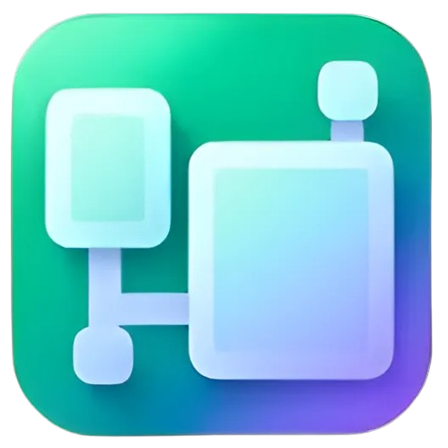
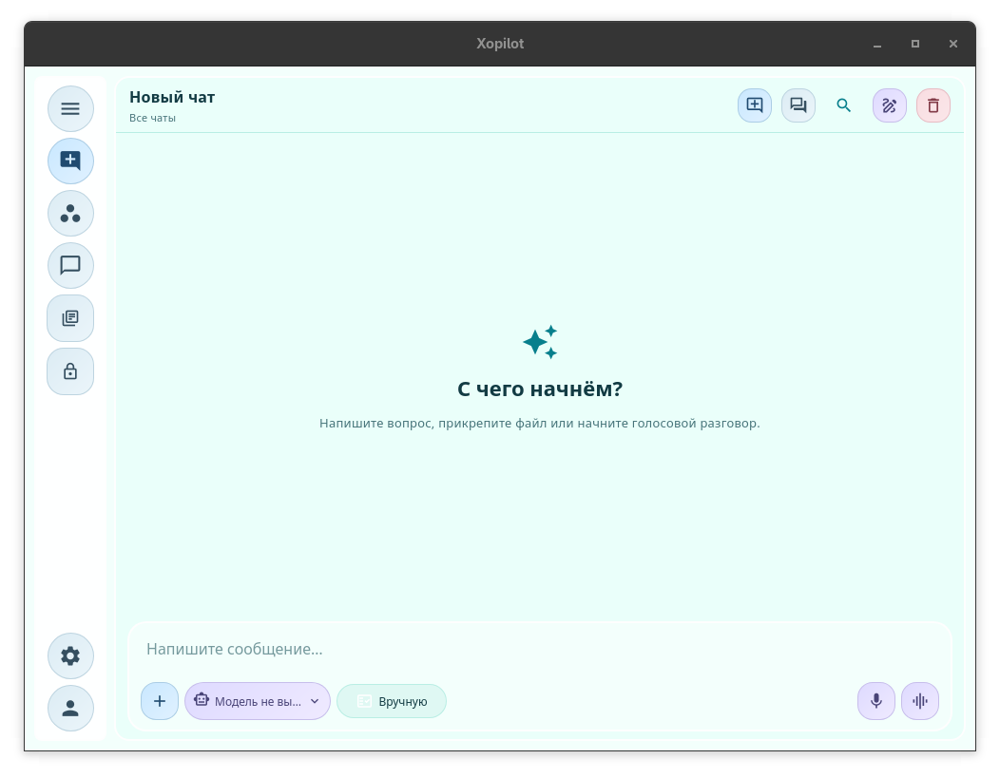
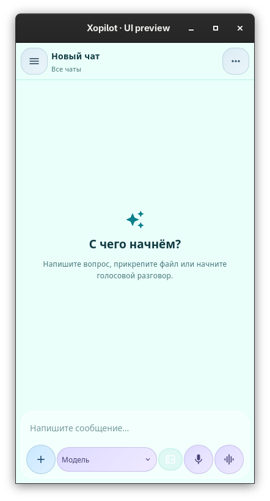
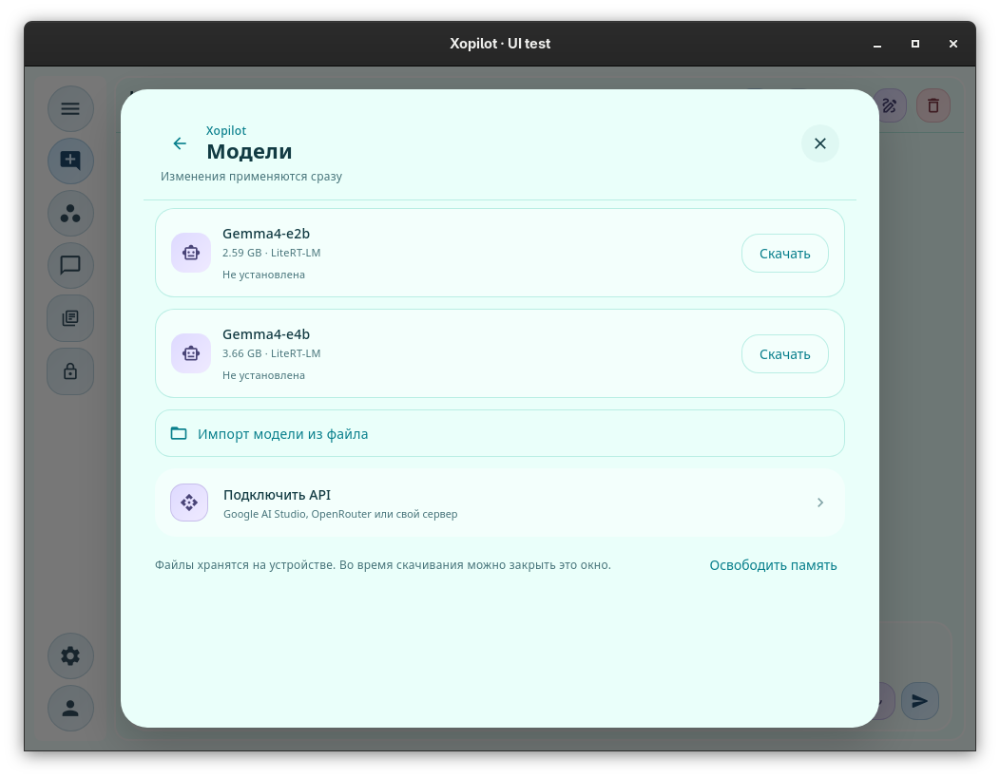
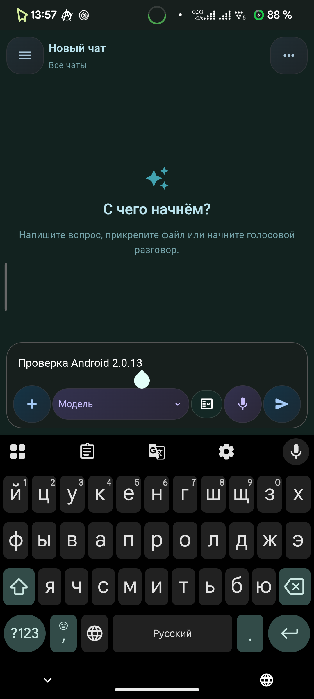
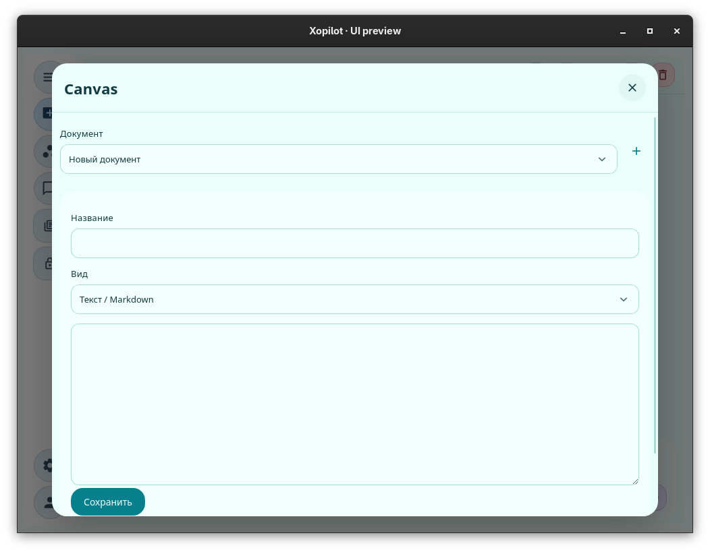
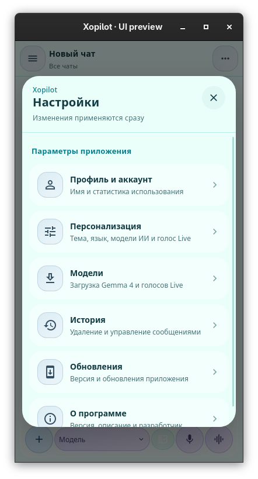

<div align="center">
  
  <h1>Xopilot</h1>
  <p><strong>Your AI. Your projects. Your devices.</strong></p>
  <p>Chats, workspaces, Canvas, and local AI<br/>in one app for desktop and Android.</p>
  <p>
    <a href="https://github.com/Xopilot-AI-NN/Xopilot/releases">Download</a> ·
    <a href="#features">Features</a> ·
    <a href="#quick-start">Development</a> ·
    <a href="tests/RUST_DIOXUS.md">Test reports</a> ·
    <a href="mailto:support@xopilot.by">Support</a>
  </p>
  <p>
     
     </p>
</div>

**Language:** [Русский](README.md) · **English**

> **In development · Rust 2.0.13.** The UI and services have been migrated to Rust / Dioxus. Some features from the previous version are still being ported; see [MIGRATION.md](MIGRATION.md) for the status of each area. Test results are available for [Rust / Linux](tests/RUST_DIOXUS.md) and [Android](tests/ANDROID_DEVICE.md). A successful local build does not mean that a new release has already been published.

## Screenshots

Six views of Xopilot Rust Edition. Click any image to view it at full resolution.

<table align="center">
  <tr>
    <td align="center" valign="middle">
      <a href="previews/dioxus-main.png"></a>
      <sub>Chats</sub>
    </td>
    <td align="center" valign="middle">
      <a href="previews/dioxus-mobile.png"></a>
      <sub>Mobile UI</sub>
    </td>
    <td align="center" valign="middle">
      <a href="previews/dioxus-models.png"></a>
      <sub>Local models</sub>
    </td>
  </tr>
  <tr>
    <td align="center" valign="middle">
      <a href="previews/android-keyboard.png"></a>
      <sub>Android</sub>
    </td>
    <td align="center" valign="middle">
      <a href="previews/dioxus-canvas.png"></a>
      <sub>Canvas</sub>
    </td>
    <td align="center" valign="middle">
      <a href="previews/dioxus-mobile-settings.png"></a>
      <sub>Settings</sub>
    </td>
  </tr>
</table>
## What's new in dev-v2.0.13

Compared with the latest published prerelease, [dev-v2.0.12](https://github.com/Xopilot-AI-NN/Xopilot/releases/tag/dev-v2.0.12):

- Migrated the UI and services from Python / Flet to **Rust / Dioxus**, removing Python environments, PyO3, and Flutter from the build. Preserved the directory architecture and the descriptive Rust coding style, including Russian-language comments.
- Restored the familiar layout: menus, cards, color palettes, Canvas, and settings layered over the chat. Fixed lists, window dimensions, and independent scrolling across sections.
- Integrated native **LiteRT-LM** with Gemma4-e2b/e4b. Added SHA-256 verification, one-click file selection, automatic GPU/CPU selection, and memory release. Model weights and the compatible KV context are reused between requests.
- Ported the agent loop: reading and modifying project files, running commands, using Canvas and memory, and searching chats. Added approvals, pause and stop controls, and action cards inside conversations; fixed internal JSON leaking into replies and checks for unverified claims of success.
- Simplified local profiles: one is created automatically. Names and avatars can be changed by clicking them; Google and email registration still rely on the server and require it to be enabled.
- Fixed the Android system Back button: open dialogs close in order, and Back from the root chat backgrounds the app. The chat, draft, section, and scroll position are saved so they can be restored after Android kills the process.
- Moved Android model downloads to the system **DownloadManager**. Downloads and percentage notifications continue even when the UI process is gone; the same task is restored when the app returns. Delivered files are checked against SHA-256 before installation. Downloads resume automatically after waiting for a network connection; manual cancellation removes the system task. On desktop, the previous pause-and-resume behavior using HTTP Range remains available.
- Corrected the safe-area insets for the status bar, display cutout, and navigation bar. The keyboard moves the composer up, and the UI returns to its original position when the keyboard closes. Notifications disappear after **3 seconds**, while active progress remains visible.
- Restored the **Xopilot** name, icon, and application ID **by.xopilot.app**. Aligned Android ELF/ZIP files to 16 KiB and increased versionCode to **2000013**. Created a persistent signing key for future Rust builds and stored it in GitHub Secrets, outside the source tree.
- Adapted the existing automated build and prerelease workflow to Rust: **Xopilot-Dev-2_0_13-Linux.zip + Xopilot-Dev-2_0_13-Linux**, **Xopilot-Dev-2_0_13-Windows.zip + Xopilot-Dev-2_0_13-Windows.exe**, and **Xopilot-Android-arm64-v8a.apk and Xopilot-Android-x86_64.apk**. Fonts, the logo, and the native AI runtime are embedded in the executables.
- Added reproducible checks for services, the real UI, KV context, the Android bridge, and APK alignment. Commands are documented in [TESTING.md](tests/TESTING.md), with on-device results in [ANDROID_DEVICE.md](tests/ANDROID_DEVICE.md).

**Important when upgrading from 2.0.12:** The Android signing certificate has changed. The new APK cannot update an installation signed with the old certificate. **Do not uninstall the old app before exporting any chat history you need.** Copying the SQLCipher database file alone does not preserve its Android Keystore key. The private signing key for the new version is stored separately and is not included in Git or application archives. The public certificate SHA-256 fingerprint is available in [signing-certificate.sha256](App/android/signing-certificate.sha256).

**Still being ported:** Live, voice features, camera and screen capture, protected chats, cloud synchronization, billing, and remote devices. This release changes the application stack; these features should not be assumed to have the same availability as in the Flet prerelease. See the full table in [MIGRATION.md](MIGRATION.md).

**Android startup:** Removed the separate history-loading screen and began initializing SQLCipher in parallel with WebView. On the POCO X5 5G, returning from the background takes 32–152 ms; a full cold start in the tested release preview takes about 1.52 seconds. See the conditions of that measurement in the [Android test report](tests/ANDROID_DEVICE.md).

## Features

| Area | What Xopilot can do |
|---|---|
| **Chat** | Chat and message history and search, local bookmarks, editing, Markdown export, prompt templates, attachments, streaming replies and cancellation, and selection of a local model or API |
| **Projects** | Workspaces with instructions and a selected directory; code search, reading and editing files, Git status/diff, and running commands in a connected project |
| **Canvas** | Text and Markdown, code, sandboxed HTML preview, document saving and switching; drawings from the previous version are retained, but the drawing editor is still being ported |
| **Memory** | Personal instructions and saved facts, editing under personalization, and agent-assisted saving with confirmation |
| **Agent** | Project files, Canvas, chat search, and memory; expandable action results within conversations, pause and stop controls, approvals, or an explicitly selected automatic mode |
| **Local models** | Gemma4-e2b/e4b through the bundled LiteRT-LM runtime: SHA-256-verified downloads, one-click import of `.litertlm` files, automatic GPU/CPU selection, and memory release |
| **Account** | Automatically generated device profile without registration, clickable name and avatar editing; Google, email sign-in, and registration forms for the previous backend |
| **Live** | A voice interface is planned; dictation, voices, camera, and screen support are still being ported |
| **Across devices** | Synchronization, linked computers, and remote tasks from the previous version are not yet connected to the Rust UI |
| **Storage and privacy** | History and settings in SQLCipher, local attachments and exports; cloud materials and password-protected private chats are still being ported |

Local models and your own API key can be used without purchasing a Xopilot cloud model. The built-in model runs without an external server. You can also connect Ollama or llama-server through an API, but those servers must be started separately. Image and audio support depends on the selected model.

Local model weights remain in memory between requests. When a conversation continues, the existing context is extended; editing the history or instructions rebuilds the context without reloading the weights. The native context window is currently limited to 4,096 tokens, and automatic summarization of long conversations has not yet been ported. Extended tool history is shortened before the window fills up. The original messages remain in the database.

The agent validates response formats and tool results. Typical claims of completion without a successful tool action are returned to the model for correction; this is not a guarantee that every request will be understood correctly. Explicitly quoted text for Canvas creation is checked before being written. The app restricts access to the selected project directory and verifies approvals independently of model output.

A connected project supports code search, Git integration, and an editor that detects external file changes. A file modified after the agent opened or read it cannot be overwritten using an outdated revision. Commands run with the current user's permissions in the selected directory, with time and output limits. **This is not an isolated operating-system sandbox.**

The interface uses shared color palettes, cards, lists, and indicators. Each panel retains its own scroll position. Notifications appear above the chat composer or in the upper-right corner outside the chat and disappear after 3 seconds; active downloads and approval prompts remain visible. Subtle animations respect `prefers-reduced-motion`.

## Platforms

- **Linux** — primary desktop UI, local AI, and project tools. Gemma4-e2b has been tested on the CPU; e4b and GPU execution have not been tested separately.
- **Android** — Dioxus Mobile and the system WebView, Android Keystore, and an adaptive UI. Rust 2.0.13 is being tested on a POCO X5 5G using a separate installation. System bars, display cutouts, and the on-screen keyboard are handled. Details are in [ANDROID_DEVICE.md](tests/ANDROID_DEVICE.md).
- **Windows** — platform-specific paths and integration are provided, but the latest build has not been tested separately.
- **ChromeOS** — not yet tested on a dedicated device.

Automatic compute selection estimates available memory: GPU is chosen when there is enough headroom, otherwise CPU is used. If GPU initialization fails before the first token is emitted, the app can fall back to CPU. Chat history is stored on-device in SQLCipher; LiteRT-LM manages tensor and KV-cache placement. Larger models may not be suitable for every phone.

## Synchronization and data protection

A profile is created automatically on first launch; local registration is unnecessary. The UUID, name, avatar, and history are preserved. Files belonging to previous local accounts are not deleted.

History, settings, and API keys are stored in SQLCipher. Local materials and exported Markdown files are stored separately from the encrypted database. An external API receives the selected chat's history and attached materials, not the entire database. The local model does not send conversations over the network.

Google sign-in, email sign-in, and registration use the previous `/api/v1` endpoints. Live testing is deferred until the server is enabled. Cloud synchronization is not yet active; existing settings and unknown fields are preserved when profiles are updated.

On Linux, data is stored under `$XDG_DATA_HOME/Xopilot` (usually `~/.local/share/Xopilot`). On Android, it is stored in the app's private directory and Android Keystore. If the encryption key is unavailable, the app reports an error instead of creating a new history over the existing one.

## Zephyr subscriptions

Cloud plans, billing, and remote tasks belong to the previous backend and are not yet connected to the Rust version. The server is offline, and payments are not enabled. The local model and a user-provided API do not require a subscription.

## Quick start

Development requires **stable Rust**, **Dioxus CLI 0.7.10**, Node.js 24 for packaging and checks, and the target platform's system libraries. Python, Flet, and Flutter are not required. The app's directory structure has been preserved, and Rust modules contain Russian-language comments.

```bash
# Arch Linux
sudo pacman -S --needed base-devel pkgconf perl gtk3 webkit2gtk-4.1 xdotool curl unzip zip

# Debian / Ubuntu
sudo apt-get install build-essential pkg-config perl libgtk-3-dev libwebkit2gtk-4.1-dev libxdo-dev curl unzip zip

cargo install dioxus-cli --version 0.7.10 --locked
./scripts/prepare_runtime.sh
dx serve --desktop -p xopilot

# Build Linux with bundled assets
./scripts/build_linux.sh
# Dioxus output: target/dx/xopilot/release/linux/app/
node scripts/package_desktop.cjs linux
# Release artifacts: dist/Xopilot-Dev-2_0_13-Linux.zip and dist/Xopilot-Dev-2_0_13-Linux
```

When using `dx serve`, the process may have a name such as `xopilot-<random ID>`: Dioxus creates a copy for each new run. The normal compiled executable is named `xopilot`, while the app is called Xopilot.

`prepare_runtime.sh` downloads the pinned official [LiteRT-LM C API 1.0.0](https://github.com/google-ai-edge/LiteRT-LM/releases/tag/v0.19.1), verifies its SHA-256 checksum, and prepares license files. API functionality works without the SDK, but the built-in model does not. The runtime is included when packaging the installed app; Rust, Cargo, and the Dioxus CLI are only needed by developers. Linux packages also require the system WebKitGTK/GTK3/libxdo libraries.

```bash
# Android ARM64 + x86_64: JDK 21, SDK 35, Build Tools 34/35, NDK 27.2.12479018
rustup target add aarch64-linux-android x86_64-linux-android
export JAVA_HOME=/path/to/jdk-21
export ANDROID_HOME=/path/to/Android/Sdk
export ANDROID_NDK_HOME="$ANDROID_HOME/ndk/27.2.12479018"
./scripts/init_android_signing.sh # Run once, only if no persistent key exists
./scripts/build_android.sh
./scripts/test.sh apk-check dist/android.apk
```

Android users install the APK, and the app uses the system WebView. Updating an APK signed with the previous certificate requires the old signing key. Subsequent Rust builds are signed with one new persistent key. The separate `by.xopilot.test` package can be installed without changing the data of `by.xopilot.app`.

For release maintenance, keep a separate, securely stored backup of `.signing` along with its passwords. GitHub Secrets can supply the signing key to the build, but they do not allow you to download it again through the UI or API. `init_android_signing.sh` does not replace an existing key; do not generate a new signing identity for each release.

```bash
# Service checks
./scripts/test.sh quick
# Formatting, tests, and Clippy
./scripts/test.sh full
# Real Linux UI; requires Node.js and a graphical session
./scripts/test.sh ui
# Real local model; the original model file must already be downloaded
./scripts/test.sh model /path/to/gemma-4-E2B-it.litertlm
```

Build scripts are in [scripts](scripts), and CI is in [.github/workflows/build.yml](.github/workflows/build.yml). Reports: [Rust / Dioxus](tests/RUST_DIOXUS.md), [Linux UI](tests/UI_REVIEW.md), and [Android](tests/ANDROID_DEVICE.md). The full migration status is in [MIGRATION.md](MIGRATION.md).

## Project structure

```text
Cargo.toml      Rust workspace
App/
  main.rs       Linux / Android entry point
  app/          UI: chat, projects, Canvas, shared components
  services/     models, agent, profiles, platform features
  settings/     settings and account
  assets/       graphics, fonts, and resources
  native/       native runtime and licenses, prepared at build time
Services/       Rust / SQLCipher library
scripts/        build and artifact verification
tests/          tests and test reports
```

The backend and admin panel are deployed separately; their source code and secrets are not included in this repository. Do not post API keys, tokens, personal conversations, or OAuth files in issues.

## Feedback

Found a bug? Include the platform, app version and build number, steps to reproduce, and expected behavior. Contact: **support@xopilot.by**.

Developer: **DenBroLiik**. The app's source code is licensed under [MIT](LICENSE); models, voices, and third-party libraries may have their own licenses.
